# TeamPace

**Comparez votre rythme à celui de vos coéquipiers sur Le Mans Ultimate.**

TeamPace est un plugin [SimHub](https://www.simhubdash.com/) fait pour un petit groupe de pilotes
qui se connaissent : votre équipe, vos amis. Chacun garde ses propres données, les partage via un
simple dossier Google Drive commun, et tout le monde peut se comparer côte à côte : carrière,
records, sessions courues ensemble, tour par tour, télémétrie. Les données servent aussi à préparer
les courses d'endurance : un planificateur calcule les relais à partir de vos propres mesures.

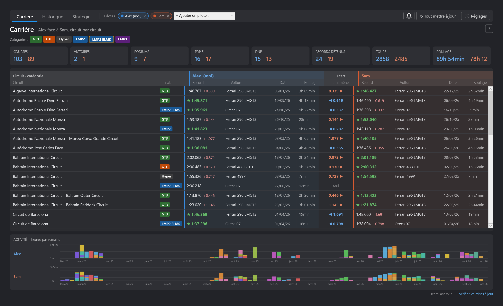

- [Ce que fait TeamPace](#ce-que-fait-teampace)
- [Installation](#1-installation)
- [Premiers réglages](#2-premiers-réglages)
- [Partager avec ses coéquipiers (Google Drive)](#3-partager-avec-ses-coéquipiers-google-drive)
- [Se comparer](#4-se-comparer)
- [Stratégie d'endurance](#5-stratégie-dendurance)
- [Notifications](#6-notifications)
- [Mises à jour](#7-mises-à-jour)
- [Dépannage](#dépannage)
- [Historique des versions](CHANGELOG.md)

## Ce que fait TeamPace

| | |
|---|---|
| **Comparaison entre coéquipiers** | jusqu'à 4 pilotes, une couleur par pilote, leurs résultats sur la même ligne |
| **Carrière face à face** | record de chacun par circuit et catégorie, qui mène et de combien, chiffres clés, activité semaine par semaine |
| **Historique** | une ligne par session, les sessions courues ensemble détectées automatiquement |
| **Progression** | courbe du meilleur tour de chaque pilote sur un circuit, session après session |
| **Analyse tour par tour** | secteurs, écart au coéquipier sur chaque tour, carburant, énergie virtuelle, usure des pneus, arrêts aux stands |
| **Télémétrie** | n'importe quel tour de chaque pilote superposé : écart cumulé, vitesse, pédales, rapport, volant, régime, trajectoires sur la carte du circuit |
| **Plan de travail** | les trois virages où gagner du temps, avec la phase et la mesure en cause |
| **Stratégie** | planificateur d'endurance : relais, arrêts, carburant, pneus, à partir de vos mesures |
| **Notifications** | records battus, victoires, sessions communes de l'équipe, en pop-up et sous la cloche |
| **Capture en direct** | pendant que vous roulez (SimHub ouvert) : litres par tour, usure par tour, temps dans la voie des stands et à l'arrêt |
| **Automatique** | chaque session terminée dans LMU est importée seule, serveurs privés compris |

TeamPace ne publie rien sur Internet : vos données ne vont que dans le dossier Google Drive
que **vous** partagez avec les personnes de **votre** choix.

## 1. Installation

1. Téléchargez **`User.TeamPace.dll`** depuis la [dernière version](../../releases/latest).
2. **Clic droit sur le fichier → Propriétés → cochez « Débloquer » → OK.**
   Windows bloque par sécurité les fichiers venus d'Internet ; sans cette étape, SimHub peut
   refuser de charger le plugin.
3. **Fermez SimHub**, puis copiez la DLL dans le dossier d'installation de SimHub
   (par défaut `C:\Program Files (x86)\SimHub\`).
4. Lancez SimHub et acceptez l'activation du nouveau plugin.
   **TeamPace** apparaît dans le menu de gauche.

C'est la seule installation manuelle : les versions suivantes s'installent depuis le plugin
([Mises à jour](#5-mises-à-jour)).

## 2. Premiers réglages

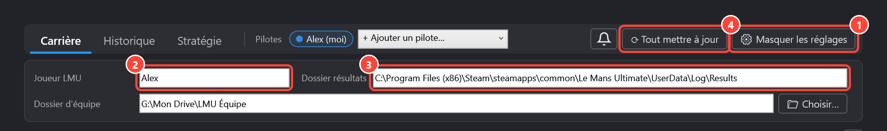

1. **⚙ Réglages** : ouvre ou replie ce panneau. Il est ouvert d'office au premier lancement, puis
   se replie pour laisser la place à vos données.
2. **Joueur LMU** : votre nom exactement comme dans Le Mans Ultimate.
3. **Dossier résultats** : le dossier des résultats LMU. Il est détecté automatiquement dans la
   plupart des cas (`…\Le Mans Ultimate\UserData\Log\Results`).
4. **⟳ Tout mettre à jour** (en haut à droite) : récupère toutes vos sessions passées, extrait la
   télémétrie enregistrée par LMU et synchronise l'équipe. La première fois, comptez une
   trentaine de secondes.

Ensuite, plus rien à faire : chaque session que vous terminez dans LMU est ajoutée toute seule,
télémétrie comprise.

## 3. Partager avec ses coéquipiers (Google Drive)

Le principe : un dossier Google Drive commun à l'équipe. Le plugin de chaque pilote y dépose
son fichier de données et y lit ceux des autres. Pas de serveur, pas de compte supplémentaire.

### 3.1 Installer Google Drive pour ordinateur (chaque pilote)

Téléchargez **Google Drive pour ordinateur** sur
[google.com/drive/download](https://www.google.com/drive/download/), installez-le et connectez-vous
avec votre compte Google. Votre Drive apparaît alors comme un **lecteur** dans l'Explorateur Windows.

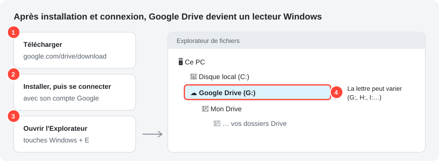

### 3.2 Créer et partager le dossier d'équipe (le capitaine, une seule fois)

Sur [drive.google.com](https://drive.google.com) : **Nouveau → Nouveau dossier**, nommez-le par
exemple `LMU Équipe`, puis partagez-le avec chaque coéquipier **en tant qu'Éditeur**.

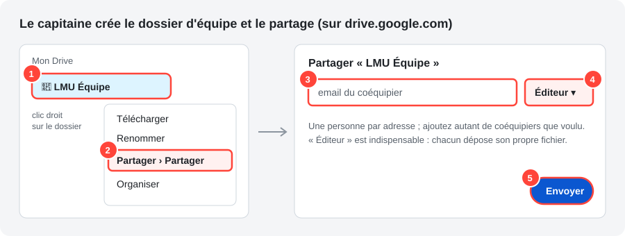

> « Éditeur » est indispensable : chaque pilote doit pouvoir déposer son propre fichier.
> Aide Google : [Partager des dossiers dans Google Drive](https://support.google.com/drive/answer/7166529).

### 3.3 Ajouter le dossier à son Drive (chaque coéquipier)

Un dossier partagé avec vous n'apparaît **pas** sur votre ordinateur tant que vous ne l'avez pas
ajouté à votre Drive. Sur [drive.google.com](https://drive.google.com) :
**Partagés avec moi → clic droit sur le dossier → Organiser → Ajouter un raccourci → Mon Drive**.

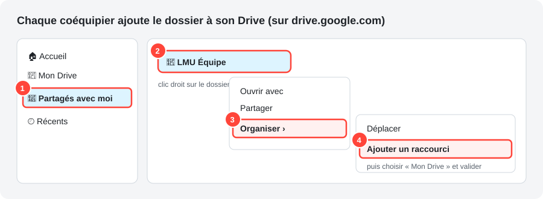

> Aide Google : [Raccourcis Google Drive](https://support.google.com/drive/answer/9700156).

### 3.4 Indiquer le dossier dans TeamPace (chaque pilote)

Dans TeamPace, cliquez sur **📁 Choisir…** et sélectionnez le dossier d'équipe dans le lecteur
Google Drive :

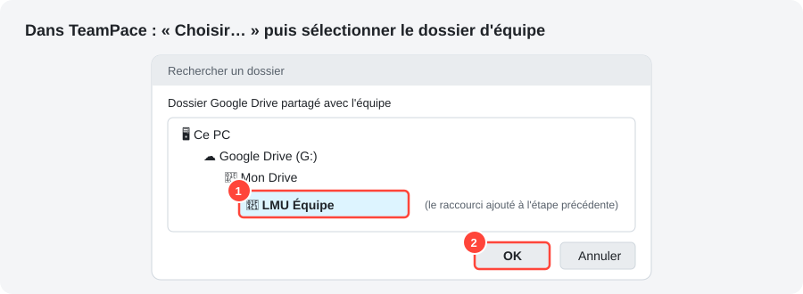

La synchronisation démarre aussitôt. Le dossier choisi s'affiche dans les **⚙ Réglages** :

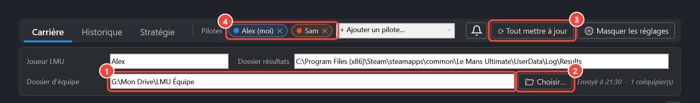

1. **Dossier équipe** : le dossier partagé sélectionné.
2. **📁 Choisir…** : pour le changer.
3. **⟳ Tout mettre à jour**, en haut à droite : force l'échange tout de suite. Sinon, c'est
   automatique (au démarrage de SimHub, à la fin de chaque session et à la fermeture).
4. **Pilotes affichés** : vous et les coéquipiers ajoutés (voir ci-dessous).

## 4. Se comparer

### Se déplacer dans TeamPace

Trois onglets en haut : **Carrière** (point de départ), **Historique** (toutes les sessions) et
**Stratégie** (préparer une course d'endurance). Deux niveaux au plus en dessous :

- un clic sur un circuit de la Carrière ouvre sa **page circuit** : *Progression*, *Télémétrie* et
  *Plan de travail* ;
- un double-clic sur une session ouvre son **analyse**, côte à côte si elle est commune.

Pour remonter : le bouton **←**, le **fil d'Ariane** au-dessus du titre (chaque niveau est
cliquable), le bouton « précédent » de la souris ou **Alt + ←**. Le bouton **?** en haut à droite
déplie l'aide de l'écran en cours ; le reste des explications est dans les info-bulles.

### Ajouter un coéquipier à l'écran

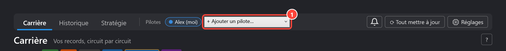

**+ Ajouter un pilote…** liste les coéquipiers dont le fichier est arrivé dans le dossier d'équipe,
jusqu'à 4 pilotes affichés. Le **✕** sur son nom le retire. Leurs données sont en lecture seule :
vous ne pouvez rien modifier chez eux, et eux rien chez vous.

### Carrière, face à face


Les chiffres clés de chaque pilote côte à côte, puis **une ligne par circuit et catégorie** avec le
record de chaque pilote sur la même ligne : un bloc teinté à sa couleur par pilote (record, voiture,
date, temps roulé). Le plus rapide est en vert (★), l'écart des autres en rouge ; la colonne
**Écart** indique qui mène et de combien. Les étiquettes de catégorie filtrent le tableau.

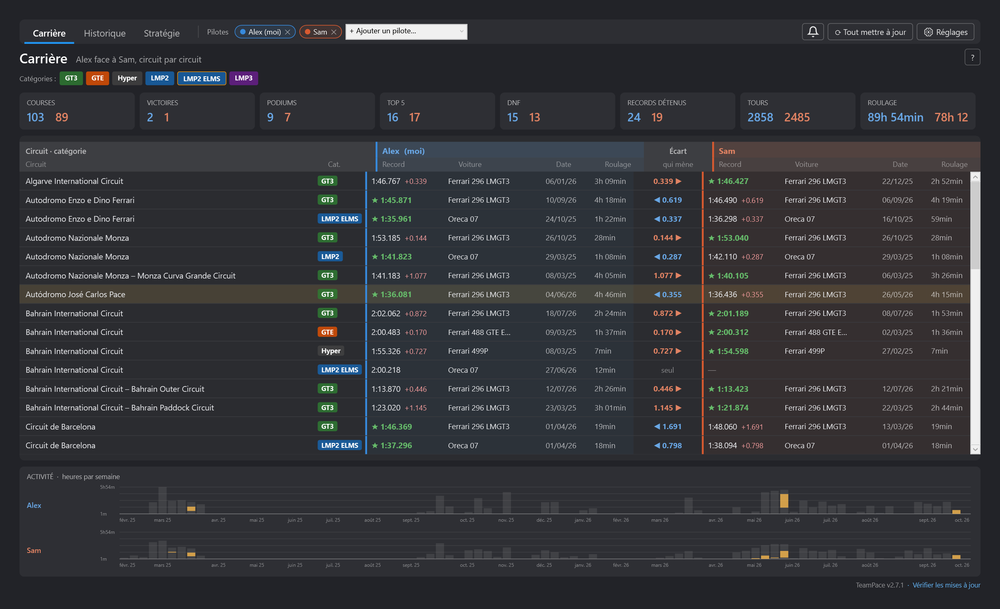

Un **clic** sur une ligne fait ressortir ce circuit dans l'activité de chaque pilote (heures par
semaine, une couleur par circuit) ; à l'inverse, un clic sur une barre de l'activité sélectionne sa
ligne. Un **double-clic** ouvre la page du circuit.

### Page circuit : progression

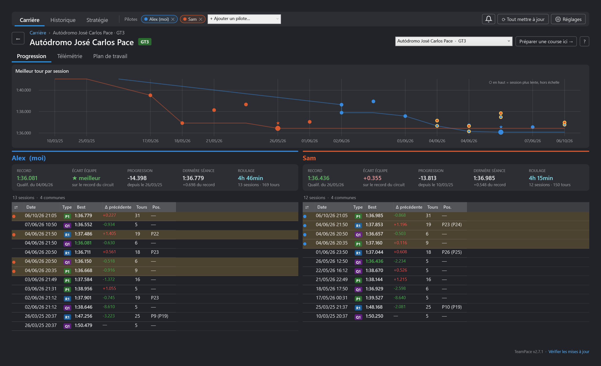

Le menu en haut à droite change de circuit sans revenir en arrière ; **Préparer une course ici**
ouvre la stratégie déjà réglée sur ce circuit.

La **courbe** : chaque point est le meilleur tour d'une session, une couleur par pilote, et la ligne
suit le record de chacun. **Plus c'est bas, plus c'est rapide** (★ = record, anneau doré = session
commune). Un clic sélectionne la session dans les tableaux ; un double-clic l'analyse. Sous la
courbe, les chiffres clés de chaque pilote : record, écart au meilleur de l'équipe, progression,
dernière séance et temps roulé.

### Historique

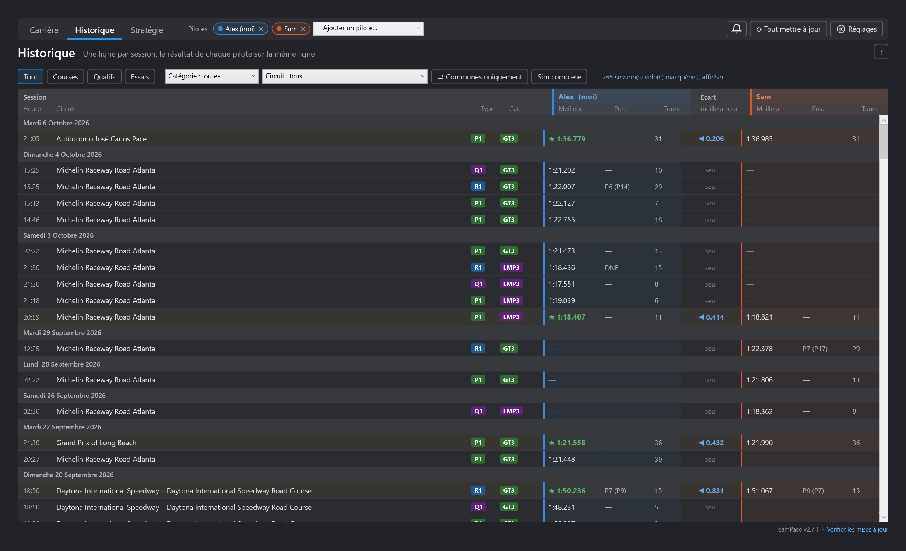

Une ligne par session, groupées par jour. Une session courue par plusieurs pilotes affichés n'occupe
qu'**une ligne** (fond doré), avec le résultat de chacun dans son bloc et l'écart au milieu. Filtres :
type de session, catégorie, circuit, **⇄ Communes uniquement** et **Sim complète**. Les sessions
sans aucun tour chronométré sont masquées (un lien les réaffiche). Double-clic : l'analyse.

### Analyse côte à côte

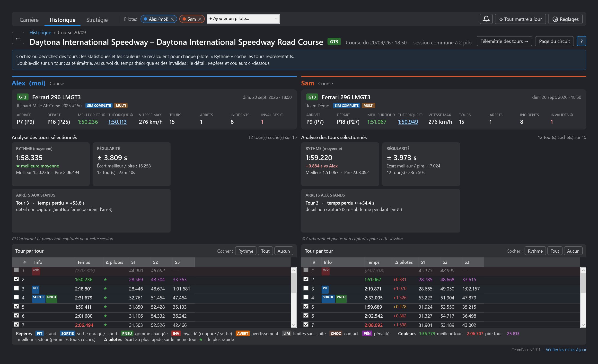

Chaque colonne se lit de haut en bas :

- la **carte de session** : voiture, équipe, et les chiffres clés (arrivée, départ, meilleur tour,
  théorique, vitesse max, tours, arrêts, incidents, tours invalides). Au survol du **temps
  théorique** : les trois meilleurs secteurs et le tour où chacun a été réalisé. Au survol de
  **Invalides** : le détail des limites de piste, des contacts et des pénalités de la session ;
- l'**analyse des tours cochés** : *Rythme* (moyenne et écart à la meilleure moyenne de l'équipe),
  *Régularité* (écart-type), carburant, énergie virtuelle, usure des pneus et arrêts aux stands
  avec le temps perdu, le carburant ajouté et les pneus changés ;
- le **tableau tour par tour** : **Δ pilotes** donne l'écart au plus rapide de l'équipe sur chaque
  tour (★ = le plus rapide). **Rythme** coche les tours représentatifs ; cochez ou décochez des tours
  et les statistiques se recalculent. Un double-clic sur un tour ouvre sa télémétrie.

Le bouton **?** affiche la légende (capture ci-dessus). Les couleurs : vert = meilleur tour,
rouge = pire tour, violet = meilleur secteur. La colonne **Info** reprend les décisions de la
direction de course enregistrées par LMU, tour par tour (détail au survol) :

| Repère | Signification |
|---|---|
| **PIT** | tour où vous êtes entré dans la voie des stands |
| **SORTIE** | tour de sortie du garage ou des stands |
| **PNEU** | changement de gomme |
| **INV** | tour **invalidé** par une coupure ou une sortie de piste |
| **AVERT** | avertissement pour limites de piste |
| **LIM** | dépassement des limites de piste, sans conséquence |
| **CHOC** | contact (mur, autre voiture) |
| **PÉN** | pénalité reçue pendant ce tour |

Les tours de stand et de sortie ne sont **pas** comptés comme invalides. LMU ne donne pas de chrono
pour les tours sans temps officiel : TeamPace le reconstitue à partir du départ du tour suivant et
l'affiche **entre parenthèses**, sans jamais le compter dans les statistiques. Un retour au garage
(Échap) n'est pas pris pour un arrêt aux stands.

### Page circuit : télémétrie

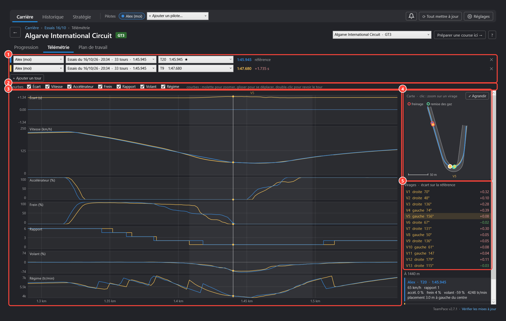

LMU enregistre toute la télémétrie de chacun de vos relais (dossier `UserData\Telemetry`).
TeamPace en extrait chaque tour, le partage avec l'équipe par le dossier Google Drive et le
superpose à ceux des autres pilotes. Elle s'ouvre depuis l'onglet **Télémétrie** de la page circuit,
le bouton **Télémétrie des tours** d'une analyse, ou un **double-clic sur un tour**.

1. **Un tour par ligne**, jusqu'à 4 : pilote, séance (ou *Toutes les séances* pour choisir parmi
   les meilleurs tours du circuit) et tour. Le premier tour sert de **référence**.
2. **Courbes** : cochez celles à afficher. L'**écart** montre, mètre par mètre, le temps gagné ou
   perdu sur la référence : une courbe qui monte, c'est du temps perdu. Molette pour zoomer,
   glisser pour se déplacer, double-clic pour revoir le tour entier.
3. Les **noms des virages** au-dessus des courbes, et les valeurs de chaque tour sous le curseur à
   droite.
4. **La carte** suit le zoom des courbes : piste avec ses bords, ligne de chaque tour, **début de
   freinage** (anneau rouge) et **remise des gaz** (anneau vert) de chaque pilote. Un clic sur un
   virage zoome dessus ; **⤢ Agrandir** la passe en grand.
5. **Virages** : le temps gagné ou perdu sur la référence dans chacun (leur somme fait l'écart au
   tour). Un clic zoome dessus.

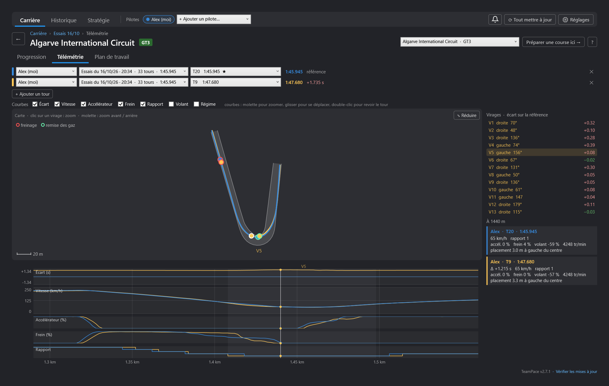

Les trajectoires sont reconstruites à partir du placement latéral enregistré par LMU, précis au
centimètre, sur un tracé moyen calculé automatiquement avec les meilleurs tours de toute l'équipe :
chaque circuit roulé par l'un d'entre vous a son tracé, sans rien à configurer. La télémétrie est
extraite automatiquement à la fin de chaque session, et à la demande avec **⟳ Tout mettre à jour**
(environ 16 Ko par tour).

### Page circuit : plan de travail

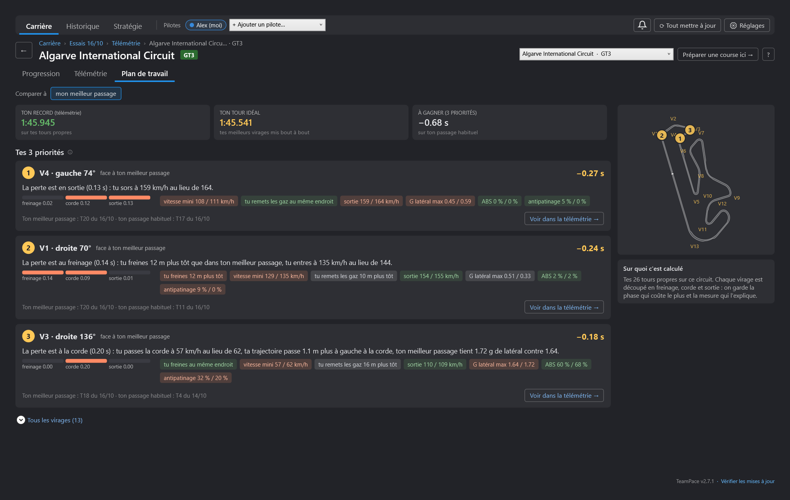

Plutôt qu'une avalanche de chiffres, **les trois virages où travailler**, classés par temps à
gagner. Chaque virage est découpé en trois phases (freinage, corde, sortie) ; la phase qui coûte le
plus est expliquée par la mesure qui diffère le plus : point de freinage, vitesse à la corde, remise
des gaz, vitesse de sortie, trajectoire, force G latérale, déclenchements de l'ABS et de
l'antipatinage. Les étiquettes rouges montrent ce qui coûte, les vertes ce qui est déjà au niveau.

- **Comparer à** : ton meilleur passage dans chaque virage, un coéquipier, ou le meilleur de l'équipe.
- Seuls les écarts qui **se répètent** sur plusieurs tours comptent : un tour raté ne fait pas une
  priorité. Un virage dont le temps varie beaucoup d'un tour à l'autre devient une priorité de
  **régularité**.
- **Ton tour idéal** : tes meilleurs virages mis bout à bout.
- **Voir dans la télémétrie** ouvre les deux tours superposés, zoomés sur ce virage.

## 5. Stratégie d'endurance

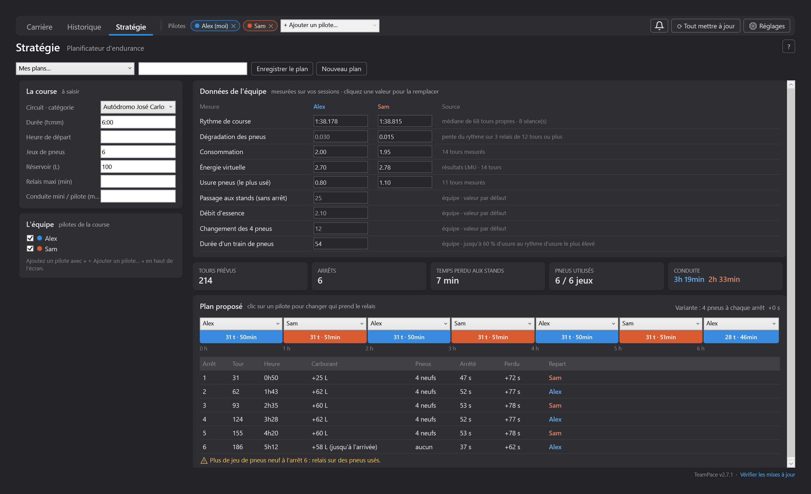

- **La course** (à gauche) : circuit et catégorie, durée, heure de départ, jeux de pneus,
  réservoir, relais maximum et temps de conduite minimum par pilote, puis les pilotes de la course.
- **Données de l'équipe** : mesurées sur vos sessions sur ce circuit et dans cette catégorie
  (rythme et dégradation de chaque pilote, consommation, énergie virtuelle, usure des pneus, temps
  aux stands, débit d'essence, changement des pneus, durée d'un train). La source de chaque valeur
  est indiquée ; tapez une autre valeur pour la remplacer (elle passe en jaune), effacez-la pour
  revenir à la mesure.
- **Plan proposé** : les relais, de la durée que permettent le réservoir et l'énergie virtuelle,
  répartis régulièrement ; les pneus sont changés quand le train arrive en fin de vie. Le menu
  au-dessus de chaque relais choisit qui le prend (Pascal, Pascal, Amaury, Amaury…) et le plan se
  recalcule. Sous le plan : chaque arrêt avec son tour, son heure, le carburant ajouté, les pneus,
  le temps arrêté et le temps perdu, et les alertes (pneus insuffisants, temps de conduite minimum).
- **Enregistrer le plan** le garde ; **Mes plans** le recharge.

## 6. Notifications

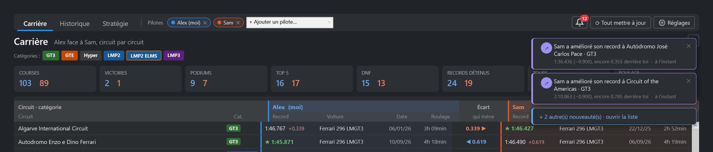

TeamPace surveille ce que font vos coéquipiers : un record battu, un record amélioré, une course
gagnée ou un podium, une nouvelle session commune, de la télémétrie reçue. Chaque nouveauté
s'affiche en **pop-up** en haut à droite (fermez-la avec ✕), et s'ajoute sous la **cloche** :
le chiffre rouge compte celles que vous n'avez pas encore lues.

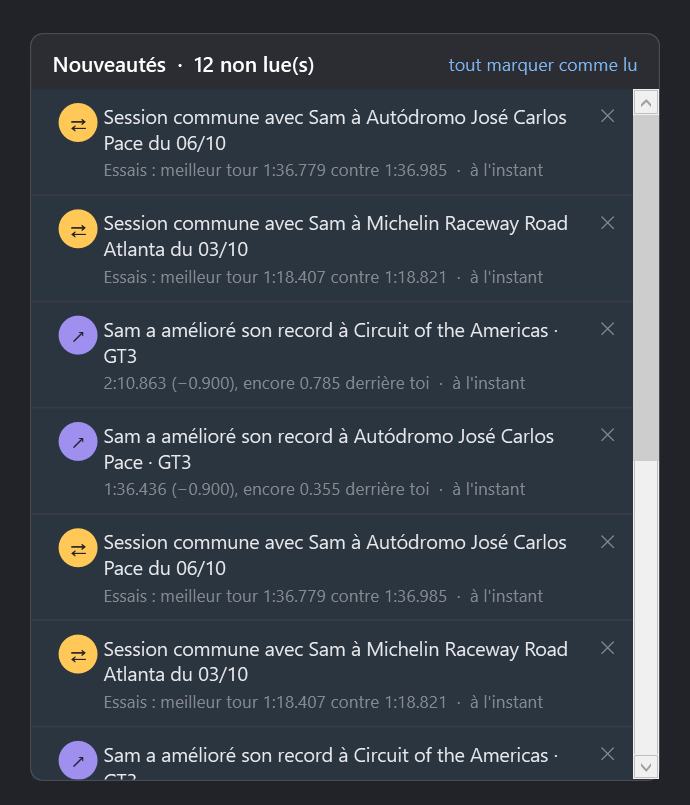

Les nouveautés s'accumulent tant que vous ne les avez pas vues, même SimHub fermé ou le plugin pas
ouvert. Un clic ouvre ce dont il s'agit (la session, le circuit) ; **✕** supprime ;
**tout marquer comme lu** vide le compteur. Pendant que SimHub tourne, l'équipe est consultée toutes
les 5 minutes.

## 7. Mises à jour


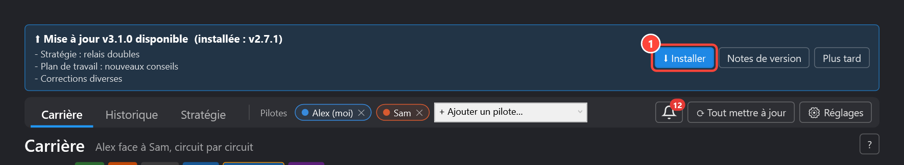

Au démarrage de SimHub, TeamPace vérifie s'il existe une nouvelle version. Si oui, un bandeau
affiche les nouveautés :

1. **Installer** : le fichier est téléchargé depuis ce dépôt et vérifié (empreinte SHA-256, nom et
   version) avant d'être mis en place. **Redémarrez SimHub** pour activer la nouvelle version.

Si SimHub est installé dans `C:\Program Files…`, Windows peut demander une autorisation
administrateur. Le lien **Vérifier les mises à jour**, en bas à droite du plugin, relance la recherche.

## Dépannage

| Problème | Solution |
|---|---|
| TeamPace n'apparaît pas dans SimHub | Vérifiez l'étape « Débloquer » de l'installation, puis relancez SimHub. |
| Aucune session après l'import | Le **nom de joueur** doit être exactement celui de LMU ; vérifiez le **dossier résultats**. |
| Un coéquipier n'apparaît pas dans « + Ajouter un pilote… » | Il doit avoir choisi le même dossier d'équipe et lancé SimHub au moins une fois. Cliquez ensuite sur **⟳ Tout mettre à jour**. |
| Le dossier d'équipe est introuvable dans « Choisir… » | Le coéquipier doit d'abord l'**ajouter à son Drive** (étape 3.3). |
| Pas de télémétrie pour un pilote | Il doit avoir TeamPace 2.6 ou plus et cliquer une fois sur **⟳ Tout mettre à jour**. La télémétrie de LMU doit être active (dossier `UserData\Telemetry` non vide). |
| Colonnes carburant / pneus vides | Ces valeurs sont capturées en direct : roulez avec SimHub ouvert. En ligne, LMU ne les écrit pas dans ses fichiers de résultats. |

## Pour le développeur

Prérequis : Windows, SimHub installé, .NET Framework 4.8,
[GitHub CLI](https://cli.github.com/) connecté (`gh auth login`).

```powershell
# Compiler et installer dans SimHub (SimHub fermé)
$env:SIMHUB_INSTALL_PATH = "F:\Program Files (x86)\SimHub\"
& "C:\Windows\Microsoft.NET\Framework64\v4.0.30319\MSBuild.exe" User.TeamPace.csproj /p:Configuration=Release

# Publier une nouvelle version (bandeau de mise à jour chez tous les pilotes)
.\release.ps1 -Version 2.4.0 -NotesFile notes.md -Deploy
```

Le projet référence les DLL de SimHub via `SIMHUB_INSTALL_PATH` : elles ne sont pas incluses dans ce
dépôt. Les données des pilotes (`PluginsData\Common\TeamPace\`) ne sont jamais publiées ici.
Les captures de cette page utilisent des données de démonstration anonymisées.
